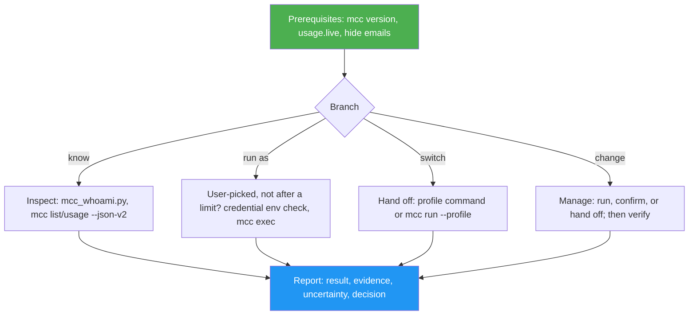

<!--
  DO NOT READ THIS FILE — This README.md is for human catalog browsing only.
  It ships inside the .skill package but is NEVER auto-loaded into agent context.
  The runtime loader only reads SKILL.md + references/ + scripts/ + agents/ when the skill triggers.
  If you're an AI agent, read the SKILL.md file instead for skill instructions.
-->

# mcc Accounts

> Inspect and use Claude Code accounts (mcc profiles): which one a session or repo uses, usage, login expiry, running commands or `claude -p` as a profile, mapping, syncing.

## Highlights

- Tells apart the account a Claude Code session runs as and the account `mcc run` would start in a directory, even for renamed profiles whose folder keeps the old name
- Reports every account's 5-hour and weekly usage and upcoming login expiry from mcc's cache, without reading tokens
- Runs a command or a headless Claude task as an account you name (`mcc exec`), keeping stray `ANTHROPIC_API_KEY`-style variables away from it
- Changes mcc settings (project mappings, the default, sync, share) only when you ask, confirming anything destructive
- Never picks or runs an account because another is at its limit, even one you name, and never builds automatic account switching: at a limit it reports the reset time and hands the choice to `mcc run`, as mcc itself does
- Acts only on accounts you name exactly (or the repo's mapping); "my work account" gets a question back

## When to Use

| Say this... | Skill will... |
| --- | --- |
| "Which Claude account is this session using?" | Resolve the session's `CLAUDE_CONFIG_DIR` to an mcc profile and compare it with the repo's mapping |
| "How much usage is left on my accounts?" | Summarize `mcc usage` per account, with cache age and any login about to expire |
| "Run this as my `work` profile" | Run it through `mcc exec work -- …`, after checking credential variables and quota |
| "Make this repo use my lab account" | Run `mcc project set lab` and verify it with `mcc run --dry-run` |
| "My account hit its limit, switch me" | Report when the limit resets, recommend waiting, and hand the choice to `mcc run` in your terminal |

## How It Works



## Usage

```
/mcc-accounts
```

Or just ask about your Claude Code accounts: the skill triggers on its own. It needs the [mcc](https://github.com/luongnv89/mcc) CLI 0.7.0+ and Python 3.

Install it from this repository with your skill manager, or copy `skills/mcc-accounts/` into `~/.claude/skills/`.

## Resources

| Path | Description |
| --- | --- |
| `scripts/mcc_whoami.py` | Resolves the session account and the directory's account, and lists credential variables that would override a profile's login |
| `references/inspect.md` | JSON fields, usage `reason` codes, exit codes, manual resolution |
| `references/run-as.md` | `mcc exec`, headless `claude -p` runs, commands that need a terminal |
| `references/manage.md` | What each mutating mcc command changes, and whether to run, confirm, or hand it off |
| `evals/` | Six eval prompts and a sandbox builder that never touches real accounts |

## Output

A short text answer that leads with the result, cites the mcc commands behind each claim, states what is uncertain (such as cache age), names any decision for you, and ends with a compact Step Completion Report.
